# Screenshots

The app in mock mode (no backend), with a fixed date, viewport and locale. Regenerate with `pnpm -C e2e screenshots` (writes `docs/screenshots/`; set `PLAYWRIGHT_CHROMIUM_EXECUTABLE` for a local Chromium, see [`e2e/playwright.screenshots.config.ts`](../e2e/playwright.screenshots.config.ts)).

## Calendar

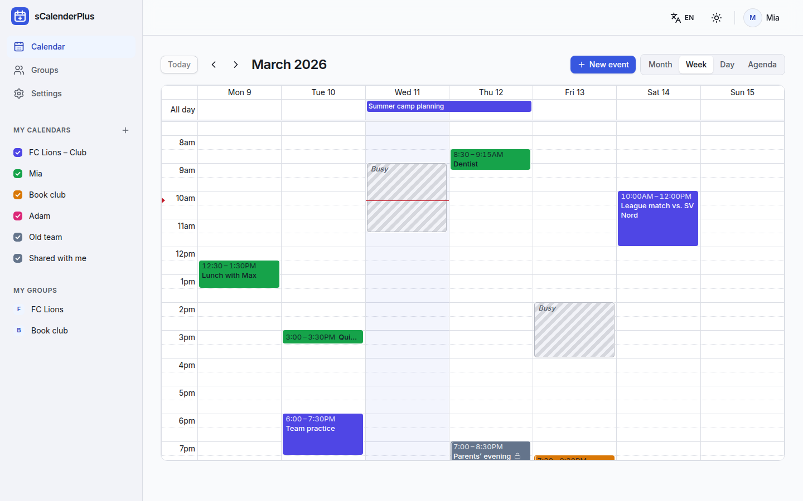

The week view overlays all calendars you can see, each in its own colour, so club, family and personal plans sit side by side.

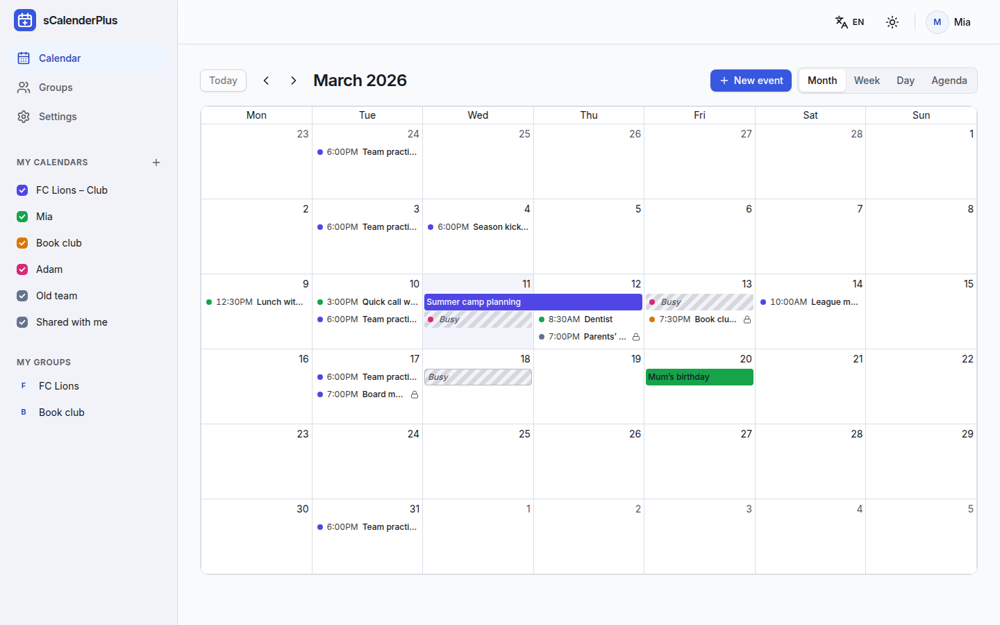

The month view keeps the same per-event permissions: busy-only entries stay anonymous and read-only events carry a lock.

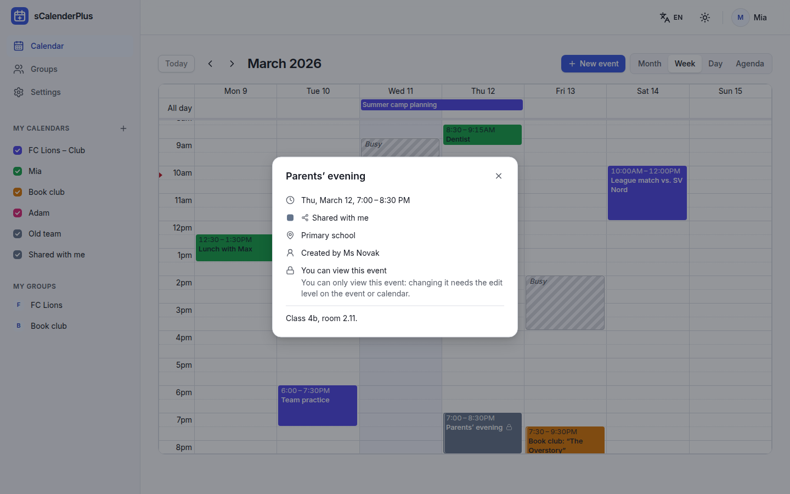

Event details say where an event comes from, who created it and exactly what you may do with it, here an event shared with you for viewing only.

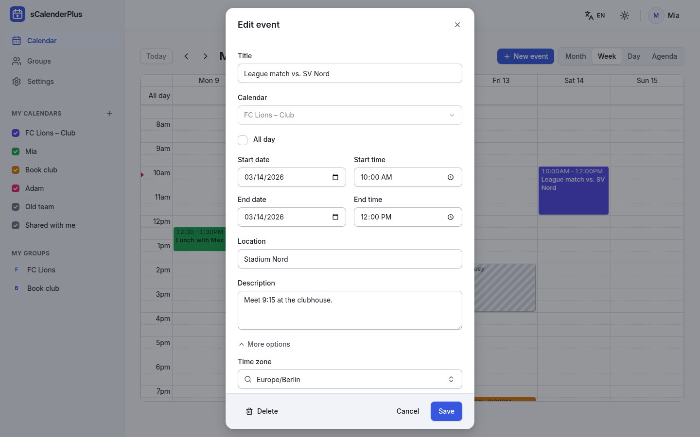

Events you may edit open in the same dialog that creates them: dates and times in your zone by default, the event's own time zone under "More options", and every save guarded against concurrent changes.

## Permissions & sharing

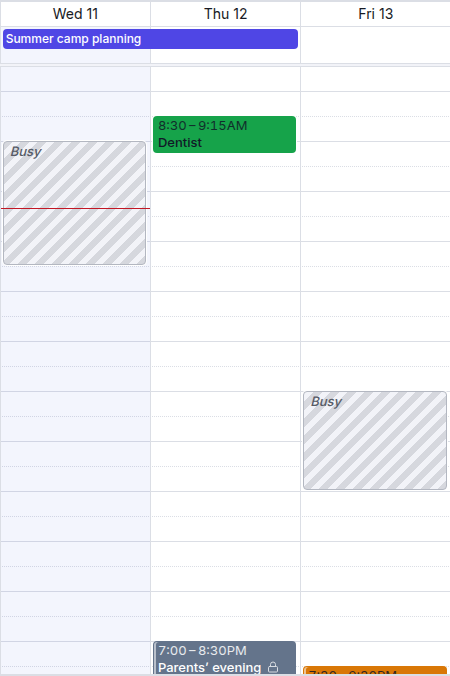

Busy-only blocks show that a colleague is unavailable without revealing title or details, right next to events you may see in full; the lock marks events you can only read.

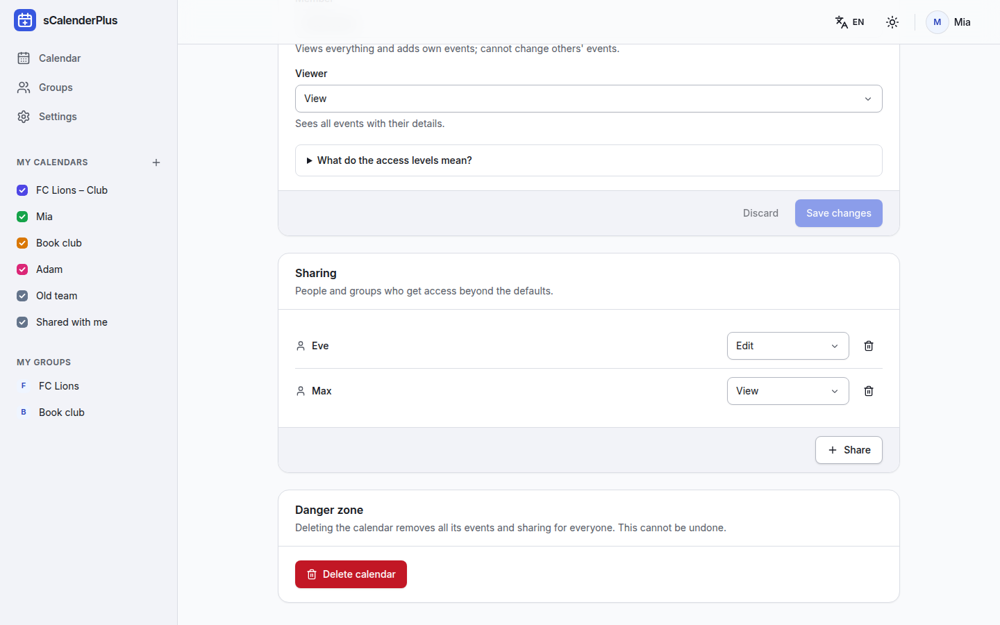

Calendar sharing grants individual people or whole groups a level (free/busy, view, add events, edit, manage) on top of the group defaults.

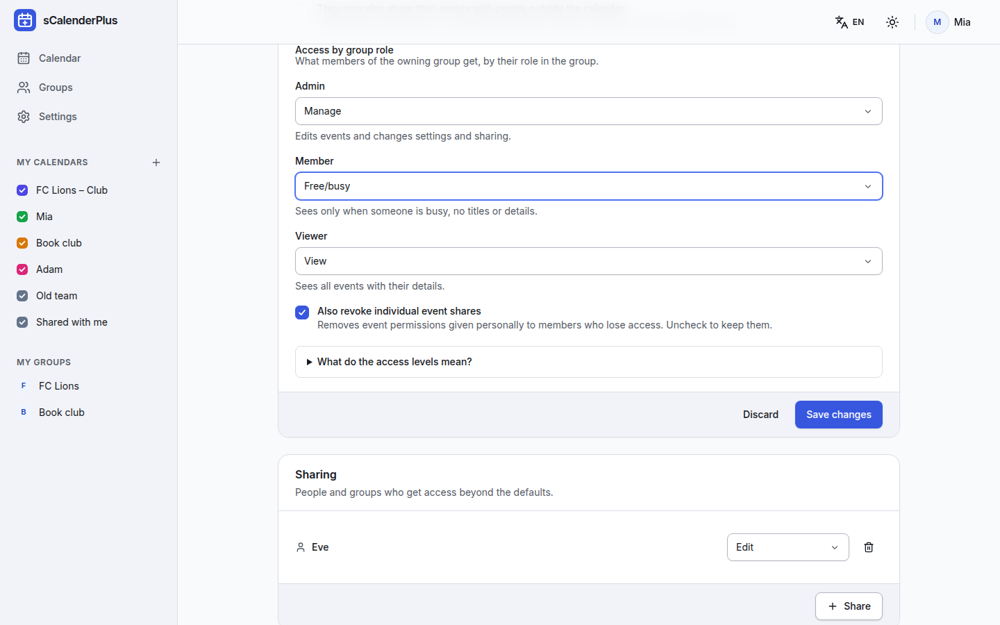

Group roles get default access per calendar; lowering a role offers to also revoke event shares given personally to those members, so nothing leaks through older per-event grants.

## Groups

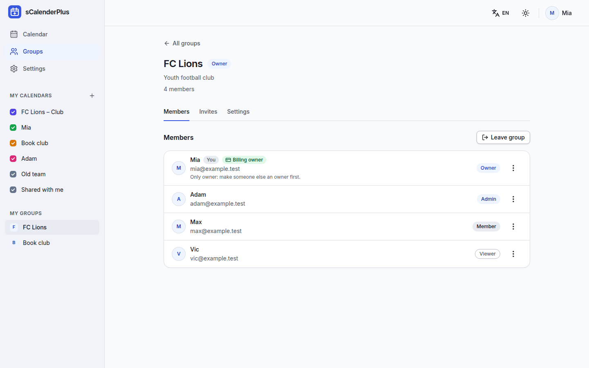

Groups have owners, admins, members and viewers; the role decides what each person gets on the group's calendars.

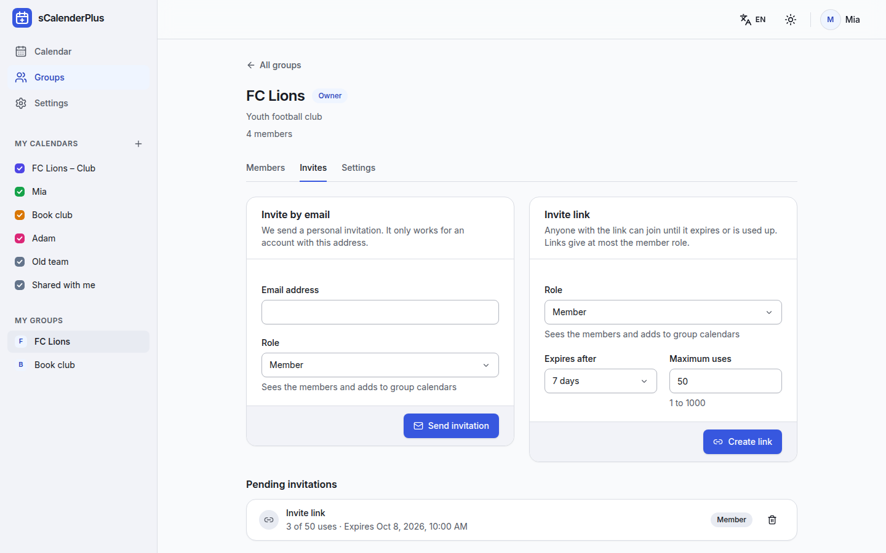

Invite people by email or with a link that expires and has a usage limit; links never grant more than the member role.

## Account

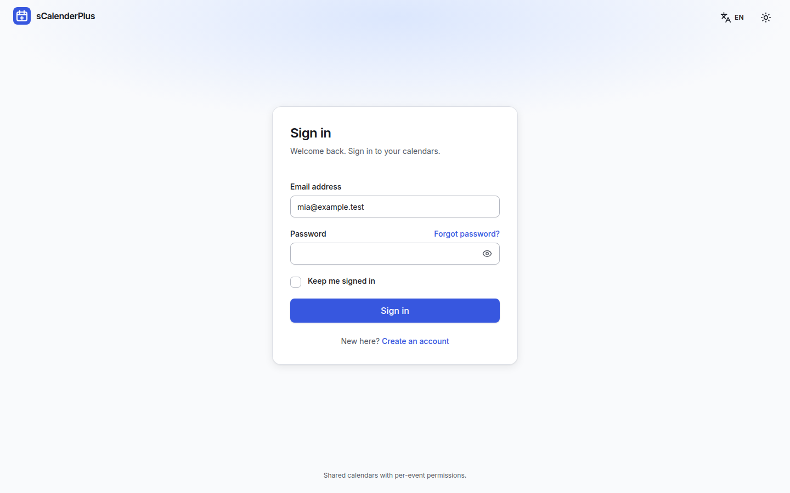

A clean sign-in with password, "keep me signed in" and self-service password reset.

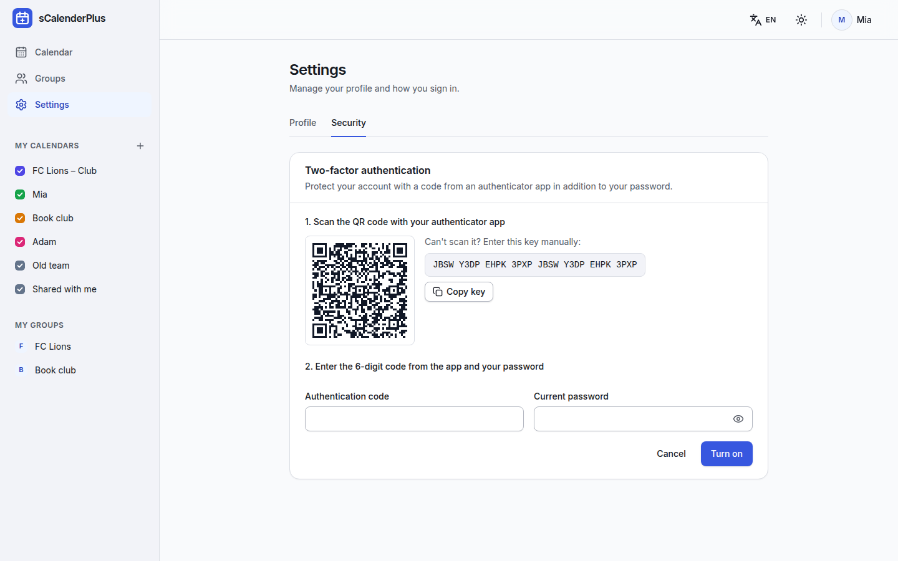

Two-factor authentication with any authenticator app, with recovery codes after setup.

## Mobile

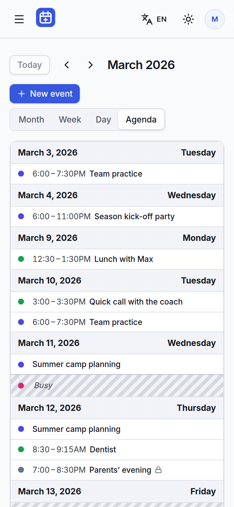

On a phone the calendar opens in the agenda view, with the same busy blocks and lock icons as on the desktop.

## Dark mode

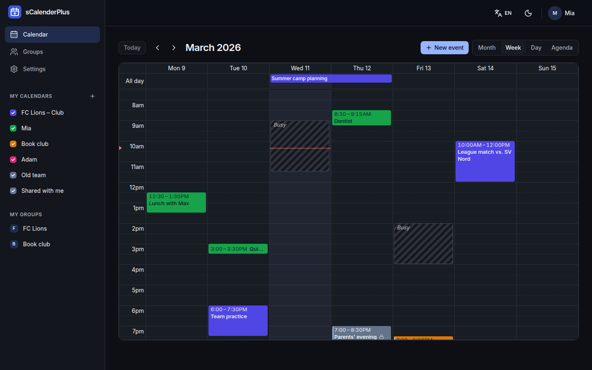

Light, dark or follow the system, remembered per device.

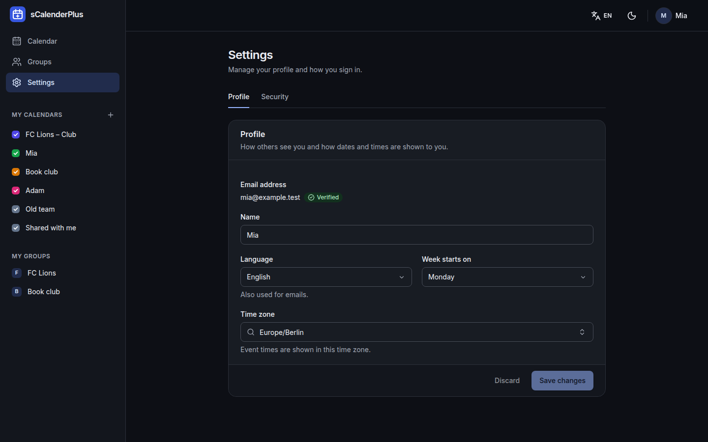

Profile settings: display name, language (also used for emails), first day of the week and time zone.

## Localisation

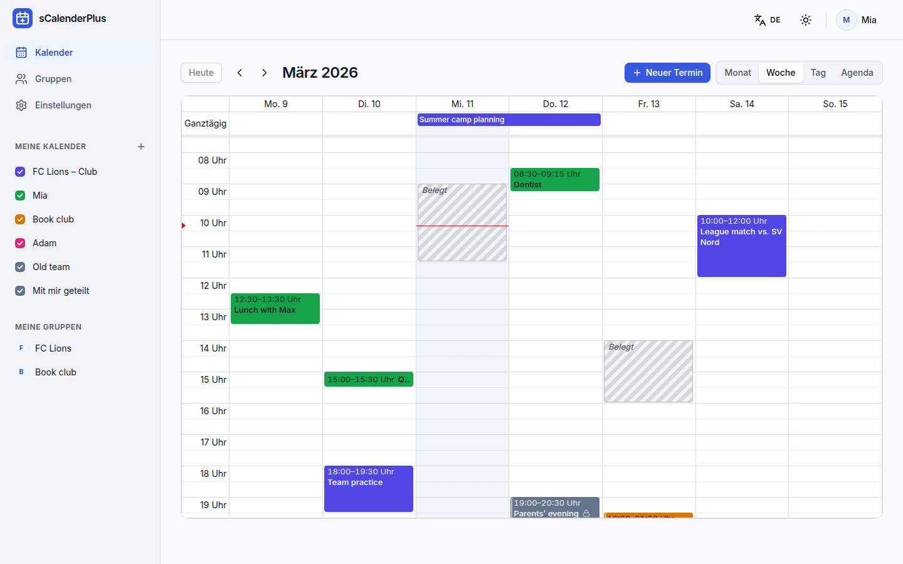

The whole app is available in English and German, including dates and times (24-hour clock in German).
